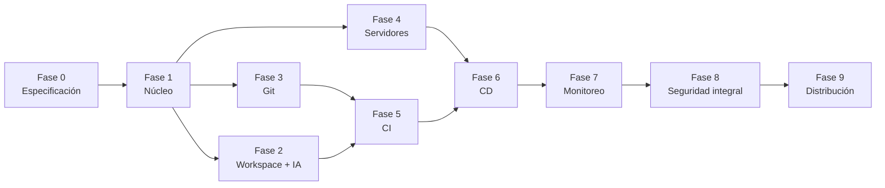

# ED Platform — Plan Maestro

**Versión:** 1.2 (renombrado a ED Platform + integraciones candidatas — ver §18)
**Estado:** Listo para ejecución (pendiente de validar spikes de la Fase 0)
**Documento complementario:** *ED-Platform-Arquitectura-y-Fases-v1.3.md* (detalle técnico, diagramas, seguridad, anexos; renombrar el archivo físico). Este plan maestro resume el qué, el cuándo, el orden y las decisiones; el documento de arquitectura es la referencia técnica.

---

## 1. Resumen ejecutivo

**ED Platform** es una plataforma **local-first** que unifica en una sola interfaz el ciclo completo de una aplicación: desarrollo asistido por IA, Git, CI/CD, gestión de servidores, terminales remotas y verificación posterior al despliegue.

**Lema propuesto:** *Alinea, ejecuta, verifica, cierra.* (refleja el flujo en 4 fases, §19)

### Qué problema resuelve
Hoy el trabajo se reparte entre el editor, el proveedor Git, el CI/CD, sesiones SSH y paneles de monitoreo. ED Platform reúne todo eso, con la IA como asistente y con controles que impiden que un cambio llegue a producción sin revisión, pruebas ni verificación real.

### Los cinco compromisos del producto
1. **Local-first:** todos los datos (código, base de datos, logs, artefactos, historial de IA, secretos, backups) residen en el equipo o servidor del usuario.
2. **Entrega verificada:** un despliegue solo es exitoso si la versión esperada está activa y las comprobaciones de salud pasan.
3. **IA con límites:** modos de autonomía, permisos por herramienta, checkpoints y aprobación humana para producción.
4. **IA continua:** si un proveedor agota su cuota, el trabajo continúa con un proveedor de respaldo configurado previamente.
5. **Trazabilidad total:** cada cambio, ejecución, despliegue y acción administrativa queda auditado.

### Resultado esperado
Un usuario o equipo pequeño puede pedir un cambio en lenguaje natural, revisarlo, probarlo, versionarlo, construirlo, desplegarlo en su propio servidor, verificarlo y recuperarse de un fallo, todo desde ED Platform y sin que sus datos salgan de su infraestructura.

---

## 2. Alcance

### Dentro de la versión 1.0
- Interfaz web (escritorio opcional después).
- Proyectos, usuarios, roles y auditoría.
- Almacén local de secretos.
- Cola de trabajos persistente y workers.
- AI Harness con workspace aislado, plan, diff, checkpoints y continuidad entre proveedores.
- Git local y adaptador GitHub.
- Catálogo de servidores Linux, terminal SSH y SFTP.
- CI en runners propios con artefactos.
- CD a entornos de desarrollo, preproducción y producción para aplicaciones web en contenedor.
- Verificación de salud y versión, rollback básico.
- Monitoreo simple y alertas iniciales.
- Instalación con Docker Compose, backups y guía de administración.

### Fuera de la versión 1.0 (se evalúa después)
- Conector Windows (PowerShell Remoting).
- Kubernetes y arquitecturas multinodo complejas.
- Estrategias Blue/Green y Canary.
- Rollback automático en producción.
- GitLab y otros proveedores Git.
- Servidor MCP propio y mercado de extensiones.
- Infraestructura como código (Terraform/Ansible) y feature flags.
- Aplicación de escritorio empaquetada (Tauri), salvo que el prototipo la justifique.
- Multi-organización y colaboración avanzada.

---

## 3. Decisiones por defecto recomendadas

Estas decisiones cierran los puntos abiertos del documento de arquitectura. Pueden cambiarse, pero deben quedar registradas como ADR (registro de decisión de arquitectura).

| # | Decisión | Valor recomendado | Motivo |
|---|---|---|---|
| 1 | Uso inicial | Personal o equipo pequeño, con modelo de roles desde el inicio | Evita rediseñar permisos después |
| 2 | Proveedor Git | Git local siempre; adaptador GitHub primero | Cobertura amplia con poco esfuerzo |
| 3 | Proveedor de IA | Interfaz agnóstica; un proveedor externo principal, uno de respaldo y modelo local opcional | Continuidad y privacidad |
| 4 | Entorno de ejecución | Linux con contenedores (Docker rootless o Podman) | Ruta práctica y verificable |
| 5 | Primer tipo de despliegue | Aplicación web en contenedor vía SSH, estrategia *Recreate* | Menor complejidad, valida todo el flujo |
| 6 | Método de servidor | SSH/SFTP en Linux; Windows más adelante | Reduce el alcance inicial |
| 7 | Ubicación inicial | Docker Compose en un equipo o servidor propio encendido de forma continua | Trabajos persistentes sin nube |
| 8 | Política de producción | Aprobación humana siempre | Seguridad por defecto |
| 9 | Acceso | Red privada o VPN; sin exponer a Internet en la v1.0 | Reduce la superficie de ataque |
| 10 | Retención | Logs 90 días; auditoría 1 año; artefactos: últimas N versiones por proyecto; backups diarios con retención semanal y mensual | Punto de partida ajustable |
| 11 | IA de respaldo | Al menos un proveedor adicional con límites de gasto, más un modelo local si el hardware lo permite | Continuidad |
| 12 | Política de continuidad de IA | *Preguntar* por defecto; *automática* solo con límite de gasto definido | Evita sorpresas de costo |
| 13 | Secretos con GitHub | Modo A (solo local) por defecto; modo B (sincronización) opcional | Local-first |
| 14 | Privacidad por defecto | Clasificación del proyecto al crearlo; IA externa con exclusión de archivos sensibles y redacción de secretos | Equilibrio entre utilidad y control |
| 15 | Backups | Destino local o NAS, cifrados, con prueba de restauración | Sin dependencia de nube |
| 16 | Modelos locales | Soportados como opción; no obligatorios | Depende del hardware |
| 17 | Licenciamiento | **Cerrada: Apache-2.0** (ADR-0003; elección intencional del propietario, LICENSE en el repo) | Grant explícito de patentes; compatible con las dependencias MIT/Apache/BSD de §19 — los AGPL siguen limitados a sidecar |
| 18 | Construir vs. integrar | Análisis explícito en Fase 0 para el AI Harness (E05) y el CI (E09): construir por defecto, salvo que un OSS maduro cubra la mayoría del alcance con licencia compatible | Evita reconstruir lo que ya existe; el spike S4 debe comparar contra frameworks de agente existentes |

### Stack inicial (hipótesis a validar en la Fase 0)
- **Interfaz:** React + TypeScript, Monaco Editor, xterm.js.
- **Backend:** TypeScript (NestJS o equivalente).
- **Datos:** PostgreSQL; cola de trabajos con **pg-boss v12 sobre PostgreSQL** (spike S3, ADR-0004; Redis descartado para la v1.0).
- **Git:** Git CLI.
- **Aislamiento:** contenedores con límites de recursos; reforzar según el spike de seguridad.
- **Servidores:** OpenSSH y SFTP.
- **Instalación:** Docker Compose.
- **Escritorio:** Tauri solo si el prototipo lo justifica.

---

## 4. Mapa de hitos

| Hito | Nombre | Contenido | Resultado verificable |
|---|---|---|---|
| **M0** | Fundamentos | Fase 0 | Especificación, modelo de datos, matriz de permisos, spikes técnicos resueltos |
| **M1** | Núcleo | Fase 1 | Aplicación ejecutable, proyectos persistentes, trabajos que sobreviven a reinicios |
| **M2** | Desarrollo con IA y Git | Fases 2 y 3 | La IA modifica un proyecto, se revisa el diff, se hace commit y se sincroniza |
| **M3** | Primer flujo completo | Fases 4, 5 y 6 (alcance mínimo) | Del cambio por IA al despliegue verificado en un servidor propio, con fallo controlado detectado |
| **M4** | Operación | Fase 7 | Panel de salud, alertas y correlación entre despliegues y fallos |
| **M5** | Endurecimiento | Fase 8 | Informe de seguridad, controles verificados, backups restaurados |
| **M6** | Versión 1.0 | Fase 9 | Instalación limpia por documentación y recuperación desde backup |

### Orden y dependencias

**Ruta crítica:** Fase 0 → Fase 1 → Fase 3 → Fase 5 → Fase 6 → Fase 8 → Fase 9. Las Fases 2 y 4 pueden avanzar en paralelo con la 3 y deben converger antes de la 5 y la 6.

---

## 5. Cronograma orientativo

Supuestos: 1 a 2 desarrolladores con experiencia, trabajo continuo, sin cambios importantes de alcance. Las cifras son referencias iniciales que se ajustan al cerrar la Fase 0.

| Fase | Duración estimada | Hito |
|---|---|---|
| 0 Especificación y spikes | 2–3 semanas | M0 |
| 1 Núcleo y UI | 4–6 semanas | M1 |
| 2 Workspace y AI Harness | 5–8 semanas | M2 |
| 3 Git y remotos | 3–4 semanas | M2 |
| 4 Servidores y terminales | 4–6 semanas | M3 |
| 5 CI | 4–6 semanas | M3 |
| 6 CD | 5–7 semanas | M3 |
| 7 Monitoreo | 3–5 semanas | M4 |
| 8 Seguridad integral | 3–4 semanas | M5 |
| 9 Distribución | 3–4 semanas | M6 |

**Totales orientativos**
- Una persona, secuencial: 36 a 53 semanas (aprox. 8 a 12 meses).
- Dos personas, con paralelismo en las Fases 2–4: aproximadamente 26 a 38 semanas (6 a 9 meses).

El valor del plan está en llegar a **M3** lo antes posible, ya que demuestra que los módulos funcionan juntos.

---

## 6. Fase 0 en detalle: especificación y spikes

### 6.1 Spikes técnicos (pruebas de concepto de riesgo)
Cada spike tiene un resultado de tipo *sí/no/ajuste* y se documenta en un ADR.

| ID | Spike | Pregunta a responder | Criterio de éxito |
|---|---|---|---|
| S1 | Aislamiento de runners | ¿Qué nivel de aislamiento ofrece contenedores rootless/Podman con límites de recursos y red restringida? | Una tarea no puede leer fuera de su workspace ni acceder a otros proyectos |
| S2 | Terminal SSH web | ¿xterm.js con un backend SSH da una experiencia estable? | Sesión interactiva con salida en tiempo real, cierre limpio y reconexión controlada |
| S3 | Trabajos persistentes | ¿La cola elegida sobrevive a reinicios y permite cancelar? | Un trabajo en curso se recupera o falla de forma coherente tras reiniciar |
| S4 | Agente de IA con herramientas | ¿Funcionan plan, edición, diff, checkpoint y rewind sobre un repo de prueba? ¿El motor carga packs de skills en formato SKILL.md? | La IA modifica el repo y se puede revertir exactamente; los packs de skills se cargan y se disparan por intención |
| S5 | Continuidad de IA | ¿Se puede cambiar de proveedor a mitad de una tarea sin perder estado? | Al simular error de cuota, la tarea continúa desde el último checkpoint con el resumen de estado |
| S6 | Almacén de secretos | ¿Cifrado por capas con clave maestra fuera de la base de datos es viable? | Un volcado de la base de datos no revela ningún secreto |
| S7 | Interfaz web vs. escritorio | ¿Basta la web local o se justifica Tauri? | Decisión justificada con prototipo |

### 6.2 Entregables
- Documento de requisitos con casos de uso priorizados.
- Modelo de datos inicial (proyectos, usuarios, roles, entornos, servidores, trabajos, ejecuciones, despliegues, secretos, auditoría).
- Matriz de permisos y límites de confianza.
- Modelo de amenazas validado.
- ADRs de las decisiones por defecto (incluidas 17 y 18: licenciamiento y construir-vs-integrar) y de los spikes.
- Backlog priorizado con criterios de aceptación.
- Plan de pruebas y repositorio base.

### 6.3 Criterio de salida (puerta M0)
- Los siete spikes tienen resultado documentado.
- Cada módulo de la v1.0 tiene alcance, entradas, salidas y criterios de aceptación.
- Las decisiones de la sección 3 están aceptadas o modificadas y registradas.

---

## 7. Fases 1 a 9: objetivos, entregables y puertas

### Fase 1 — Núcleo y UI (M1)
- **Entregables:** monorepo, API, PostgreSQL, autenticación y roles básicos, proyectos, cola de trabajos y worker, almacén local de secretos, auditoría, logs estructurados, Docker Compose de desarrollo.
- **Puerta:** reiniciar los servicios no pierde proyectos ni deja trabajos en estados incoherentes; ningún secreto aparece en la base de datos ni en los logs.

### Fase 2 — Workspace y AI Harness (M2)
- **Entregables:** workspaces aislados, chat por proyecto, plan antes de ejecutar, niveles de autonomía, permisos por herramienta, hooks de política, editor, explorador y diff, checkpoints y rewind, bucle editar → lint → prueba → corregir, reglas de proyecto, registro de acciones, continuidad entre proveedores, límites de gasto, modo local estricto.
- **Puerta:** la IA modifica un proyecto de prueba, muestra exactamente qué cambió y permite aceptar o descartar; al simular agotamiento de cuota, la tarea continúa con el proveedor de respaldo sin perder trabajo.

### Fase 3 — Git y remotos (M2)
- **Entregables:** clonar y abrir repositorios, estado, ramas, historial, diff, commits atómicos, pull/push, manejo de conflictos, adaptador GitHub, webhooks o polling, verificación y sincronización opcional de secretos con GitHub.
- **Puerta:** un cambio de la IA se revisa, se confirma en un commit y se sincroniza sin perder trabajo del usuario.

### Fase 4 — Servidores y terminales (M3)
- **Entregables:** catálogo de servidores, credenciales por referencia, terminal SSH, SFTP, estado y diagnóstico, permisos por usuario/servidor/acción, auditoría de sesiones.
- **Puerta:** el usuario ejecuta comandos y transfiere archivos en un servidor autorizado; no hay exposición de credenciales ni acceso fuera de permisos.

### Fase 5 — CI (M3)
- **Entregables:** pipelines como código, runners aislados, etapas de instalación, lint, pruebas, análisis de dependencias, escaneo de secretos y construcción de artefactos, logs en tiempo real, reportes y artefactos asociados al commit.
- **Puerta:** un commit dispara o permite ejecutar un pipeline reproducible; resultados y artefactos se consultan tras reiniciar.

### Fase 6 — CD (M3)
- **Entregables:** entornos, permisos separados, secretos y variables por entorno, promoción de artefactos identificados, aprobación de producción, bloqueo de despliegues concurrentes, estrategia *Recreate*, health checks, verificación de versión, rollback documentado, backup previo a migraciones, vista previa por PR (si el alcance lo permite).
- **Puerta:** la plataforma distingue entre comando terminado y aplicación saludable; un despliegue defectuoso no se marca como exitoso.

### Fase 7 — Monitoreo y operación (M4)
- **Entregables:** disponibilidad y latencia, versión desplegada, logs y métricas básicas, alertas y notificaciones, correlación entre despliegues y errores, historial de salud.
- **Puerta:** una aplicación que deja de responder o muestra una versión inesperada queda identificada con evidencia suficiente.

### Fase 8 — Seguridad integral (M5)
- **Entregables:** pruebas de aislamiento, de secretos, de permisos y de rutas, rate limiting, revisión de auditoría, restauración de backups, revisión de dependencias, informe de riesgos.
- **Puerta:** no hay vulnerabilidades críticas conocidas sin decisión explícita documentada.

### Fase 9 — Distribución (M6)
- **Entregables:** instalación documentada, actualizaciones con migración y vuelta atrás, backups programados y restauración probada, guía de administración, diagnóstico de instalación, verificación de que nada sale a la nube sin acción del usuario.
- **Puerta:** una instalación limpia se completa siguiendo la documentación y se recupera desde un backup probado.

---

## 8. Hito M3: primer flujo completo

Es el criterio central del plan. Se ejecuta con una aplicación web de prueba.

1. Conectar un repositorio.
2. Pedir a la IA un cambio pequeño; revisar el plan.
3. Revisar el diff y los resultados de pruebas.
4. Crear un commit y sincronizarlo.
5. Ejecutar el pipeline y obtener un artefacto.
6. Desplegarlo en un servidor de desarrollo.
7. Verificar versión y health check.
8. Provocar un fallo controlado y comprobar que se detecta.
9. Ejecutar rollback si la estrategia lo permite.
10. Simular el agotamiento de cuota de la IA en mitad de una tarea y comprobar que continúa con el proveedor de respaldo.
11. Confirmar que ningún dato salió del entorno local salvo los enviados explícitamente al proveedor de IA y al remoto Git configurados.

**Regla:** no se amplía ningún módulo (nuevos proveedores, Windows, estrategias avanzadas) hasta que M3 pase de forma repetible.

---

## 9. Backlog por épicas

Prioridad: **P0** imprescindible para M3, **P1** necesario para v1.0, **P2** deseable, **P3** posterior.

| Épica | Alcance | P0 | P1 | P2 / P3 |
|---|---|---|---|---|
| E01 Plataforma base | API, UI, datos, logs | Proyectos, navegación, persistencia | Búsqueda, ajustes | Escritorio (P3) |
| E02 Identidad y permisos | Usuarios, roles | Login, roles básicos | Permisos por entorno/servidor | 2FA, SSO (P2) |
| E03 Secretos | Almacén local | Cifrado por capas, redacción en logs | Rotación, expiración | Sincronización GitHub (P2) |
| E04 Trabajos | Cola y workers | Persistencia, reintentos, cancelación | Prioridades, concurrencia | Multinodo (P3) |
| E05 AI Harness | Agente y herramientas | Plan/Act, permisos, diff, checkpoints, bucle de verificación, failover de proveedores | Reglas de proyecto, hooks, carga de packs de skills | Subagentes, MCP, headless (P2), servidor MCP (P3) |
| E06 Workspaces | Aislamiento | Contenedores con límites | Worktrees paralelos | Reforzamiento adicional (P2) |
| E07 Git | Versionamiento | Commit, push, pull, diff | Conflictos, GitHub, webhooks | GitLab (P2) |
| E08 Servidores | SSH y SFTP | Catálogo, terminal Linux, auditoría de sesiones | — | Windows (P2), acceso temporal (P3) |
| E09 CI | Pipelines | Etapas, logs, artefactos | Escaneo de secretos, dependencias | SBOM y firma (P2) |
| E10 CD | Despliegues | Recreate, health check, aprobación | Rollback, vista previa por PR | Rolling/Blue-Green (P2), Canary (P3) |
| E11 Monitoreo | Verificación | Disponibilidad y versión | Alertas, correlación | OpenTelemetry, asistente de incidentes (P2/P3) |
| E12 Seguridad | Controles | Aislamiento, auditoría, rutas | Pruebas de seguridad | Política como código (P2) |
| E13 Distribución | Instalación | Docker Compose | Backups, actualizaciones | Instaladores (P2) |
| E14 Experiencia | UX | Flujos básicos | Bandeja de agentes, diff por bloques | Paleta de comandos, plantillas (P2) |

---

## 10. Plan de los primeros 30 días

| Semana | Foco | Resultados |
|---|---|---|
| 1 | Puesta en marcha | Repositorio `ed-platform`, estructura de monorepo, convenciones, plantilla de ADR, tablero de backlog, reserva de dominio y nombres (a rehacer con la nueva marca), definición de la aplicación de prueba, entorno de desarrollo fijado y documentado en la guía del repo (WSL2 + Docker Desktop en Windows, o Linux nativo) |
| 2 | Spikes de riesgo I | S3 (trabajos), S6 (secretos) y S2 (terminal SSH) con resultados documentados |
| 3 | Spikes de riesgo II | S1 (aislamiento), S4 (agente de IA) y S5 (continuidad) |
| 4 | Cierre de Fase 0 | S7 (web vs. escritorio), modelo de datos, matriz de permisos, modelo de amenazas validado, backlog priorizado, ADRs (incluidos licenciamiento y construir-vs-integrar) y revisión de la puerta M0 |

---

## 11. Gobierno y forma de trabajo

- **Ritmo:** iteraciones de 1 a 2 semanas con demostración funcional al final.
- **Registro de decisiones:** cada decisión técnica relevante se documenta como ADR.
- **Definición de "hecho":** cumple los criterios de aceptación, pasa las pruebas relevantes, tiene logs y auditoría, no introduce secretos en el código, documentación actualizada.
- **Puerta de calidad por fase:** criterios de salida cumplidos, pruebas pasando, riesgos documentados, errores críticos corregidos y evidencia consultable.
- **Revisión de seguridad por fase** (no solo en la Fase 8).
- **Control de alcance:** todo lo nuevo se coloca en el backlog con prioridad; no entra a una fase en curso sin retirar algo equivalente.
- **Evaluación de IA:** conjunto fijo de tareas de referencia que se ejecuta al cambiar de modelo, prompts o reglas.

---

## 12. Estrategia de pruebas

| Tipo | Qué cubre | Cuándo |
|---|---|---|
| Unitarias | Lógica de módulos | Continuo |
| Integración | API, base de datos, Git, runners, conectores | Continuo |
| End-to-end | Flujos completos desde la interfaz | Por hito |
| Seguridad | Permisos, secretos, aislamiento, rutas, comandos | Por fase y en la Fase 8 |
| Recuperación | Reinicios, desconexiones, trabajos interrumpidos, restauración | Por fase |
| Regresión | Funciones ya aceptadas | Continuo |
| Evaluación de IA | Calidad y costo por tarea, comparación entre modelos | Al cambiar modelo o prompts |
| Usabilidad | Claridad de estados y errores para no desarrolladores | Por hito |

---

## 13. Riesgos principales

| Riesgo | Impacto | Mitigación |
|---|---|---|
| Intentar construir todo a la vez | Retraso y desconexión entre módulos | Priorizar M3 y el control de alcance |
| Aislamiento de runners insuficiente | Compromiso del equipo o del servidor | Spike S1, contenedores rootless, sin socket de Docker, red restringida |
| IA con permisos excesivos o inyección de instrucciones | Fugas o acciones destructivas | Niveles de autonomía, hooks, contenido tratado como no confiable, aprobación en producción |
| Fuga de secretos | Compromiso de repositorios y servidores | Cifrado por capas, redacción, inyección just-in-time, la IA no ve valores |
| Agotamiento de tokens que frena el desarrollo | Pérdida de productividad | Failover de proveedores, checkpoints y resumen de estado |
| Consumo descontrolado de una API key | Costos inesperados | Límites de gasto y alertas |
| Perder datos locales | Pérdida de proyectos e historial | Backups cifrados y pruebas de restauración |
| Rollback incompatible con migraciones | Datos inconsistentes | Migraciones compatibles hacia atrás y backup previo |
| Exposición de la plataforma | Acceso no autorizado a todo | Acceso por red privada/VPN, HTTPS, autenticación fuerte |
| Conflicto de marca de ED Platform | Cambio de nombre tardío | Revisión de marcas y dominio antes de publicar; la reserva hecha para BerthIA no cubre el nuevo nombre |
| Bus factor con equipo de 1 | Interrupción o abandono del proyecto | ADRs y documentación al día, decisiones registradas, alcance priorizado que permite pausas; revalidar el alcance si el equipo no crece |
| Ruptura o cambio de API de un proveedor de IA | Failover degradado o costes inesperados | Interfaz agnóstica con adaptadores versionados, pruebas de contrato por proveedor, evaluación de IA al cambiar de modelo (§11) |

---

## 14. Indicadores de éxito

- Tiempo del commit a un despliegue verificado en desarrollo y en producción.
- Porcentaje de despliegues exitosos y fallidos.
- Tiempo de detección y de recuperación ante un despliegue fallido.
- Porcentaje de cambios de IA aceptados sin edición.
- Tareas de IA que continúan sin intervención tras un cambio de proveedor.
- Trabajos recuperados correctamente tras un reinicio.
- Restauraciones de backup exitosas.
- Cero datos enviados fuera del entorno local sin acción explícita del usuario.

**Umbrales provisionales (a validar en la puerta M0):**

| Indicador | Objetivo provisional |
|---|---|
| Tiempo de commit a despliegue verificado | < 30 min en desarrollo; < 2 h en producción (con aprobación humana) |
| Despliegues exitosos | ≥ 90 % por trimestre |
| Detección de despliegue fallido | < 5 min (health checks) |
| Recuperación de despliegue fallido | < 30 min (rollback documentado) |
| Cambios de IA aceptados sin edición | ≥ 60 % en tareas de referencia |
| Continuidad de IA tras failover | 100 % en las simulaciones de M3 |
| Trabajos recuperados tras reinicio | 100 % (o fallo coherente documentado) |
| Restauraciones de backup | 100 % de las pruebas programadas |
| Datos enviados fuera del entorno | 0 incidentes (binario) |

---

## 15. Identidad de marca

- **Nombre:** ED Platform. Escritura de marca: ED Platform; para repositorios y paquetes: `ed-platform`; para la CLI: `edp` (evita la colisión de `ed` con el editor Unix clásico).
- **Idea:** pendiente de definir con la nueva marca. El vocabulario náutico de la etapa BerthIA (Muelle, Astillero, Dársena, Esclusa, Zarpe, Faro, Bitácora, Vigía) queda descartado salvo decisión en contrario.
- **Comando de ejemplo:** `edp deploy`.
- **Pendiente:** significado de "ED" (p. ej. *Entorno de Desarrollo*), pronunciación, logotipo, dominio y revisión de marcas — la reserva hecha para BerthIA no cubre el nuevo nombre.

---

## 16. Próximos pasos inmediatos

1. Crear el repositorio `ed-platform` con la estructura inicial y la plantilla de ADR.
2. Definir la **aplicación de prueba** para el hito M3 (por ejemplo, una API o sitio web sencillo en contenedor).
3. Preparar un servidor de prueba (máquina virtual o equipo) para desarrollo.
4. Ejecutar los spikes S1 a S7 siguiendo el plan de las semanas 2 a 4.
5. Cerrar la puerta M0 y confirmar las decisiones de la sección 3.
6. Iniciar la Fase 1.

---

## 17. Principio rector

**Observar → planificar → modificar → validar → versionar → construir → desplegar → verificar → aprender.**

Primero el núcleo persistente y seguro; después un único flujo completo de extremo a extremo con una aplicación de prueba; y solo entonces ampliar IA, proveedores, sistemas operativos, estrategias de despliegue y monitoreo. La prioridad es una plataforma funcional y verificable, no una colección de pantallas.

---

## 18. Registro de cambios

### v1.1

Parches de completitud aplicados antes de abrir el repositorio; ninguno altera alcance, fases ni cronograma.

1. **E05 (§9):** failover de proveedores pasa de P1 a P0 — la puerta de Fase 2 (M2) y el paso 10 de M3 lo exigen, y P0 se define como imprescindible para M3.
2. **E08 (§9):** auditoría de sesiones pasa a P0 en coherencia con el compromiso 5 (trazabilidad total): una sesión de terminal es una ejecución auditada.
3. **Nuevas decisiones 17 y 18 (§3):** licenciamiento y construir-vs-integrar, a cerrar en Fase 0 (reflejado en §6.2 y §10, semana 4).
4. **Umbrales provisionales (§14):** objetivos medibles para cada indicador, a validar en la puerta M0.
5. **Entorno de desarrollo (§10, semana 1):** WSL2 + Docker Desktop (Windows) o Linux nativo, documentado en la guía del repositorio.
6. **Nuevos riesgos (§13):** bus factor con equipo de 1 y ruptura o cambio de API de proveedores de IA.
7. **CONSTRAINTS.md:** barra de calidad materializada como contrato (fuente: §11, §12 y §13 de este plan). Archivo complementario a este documento.

### v1.2
1. **Renombrado a ED Platform (§1, §15):** BerthIA → ED Platform en todo el documento; repo `ed-platform`, CLI `edp` (evita la colisión de `ed` con el editor Unix). Lema provisional alineado con el flujo en 4 fases. Pendiente: rehacer reserva de dominio/marcas y renombrar el documento de arquitectura complementario.
2. **Nuevo §19 — integraciones candidatas por fase:** herramientas OSS más populares de GitHub por fase del flujo, como insumo para la decisión 18 (construir vs. integrar). Foto de estrellas tomada de la API de GitHub (oct. 2026).
3. **§19 ampliado con packs de skills:** nuevo patrón de integración "pack de skills del agente" y tabla transversal (superpowers 298k, anthropics/skills 181k, ponytail 162k, agent-skills 106k — todo MIT salvo verificar anthropics). Spike S4 pasa a validar la carga de skills (formato SKILL.md) y E05 incluye la capa de skills en P1.
4. **§19 ampliado con packs complementarios por rol:** skills de Pocock (288k), ECC (278k), gstack (136k), UI/UX pro-max (135k), caveman (111k), revisor open-code-review (47k, ya en el stack local), auditor de seguridad de Cloudflare (29k) y skills de seguridad de Trail of Bits (7,5k); graphify añadido a la Fase 2 (126k). Excluido por falta de licencia: andrej-karpathy-skills (219k). Con varios packs cargados, el AI Harness necesitará una política de precedencia entre packs.
5. **Decisión 17 cerrada (licenciamiento):** Apache-2.0, elección intencional del propietario; registrada en ADR-0003. Remoto del repo: github.com/jorgeramos2708/ed-platform. Convención de trabajo: commit + push al cerrar cada fase, con pruebas locales.
6. **Spikes S3 y S6 ejecutados con veredicto SÍ** (ADR-0004 y ADR-0005): cola confirmada — pg-boss v12 sobre PostgreSQL (stack §3 actualizado); cifrado por capas de secretos viable con clave maestra fuera de la BD.

---

## 19. Integraciones candidatas por fase del flujo

El flujo de trabajo del usuario en ED Platform se organiza en **4 fases** (Alineación/Diseño → Contexto/Infraestructura → Generación/Ejecución → Calidad/Cierre). Cada fase se cubre combinando módulos propios con herramientas OSS de alto respaldo, mediante tres patrones de integración:

- **Librería embebida:** se incorpora al proceso de la propia plataforma.
- **Motor CLI orquestado:** la plataforma lo ejecuta desde su cola de trabajos y presenta sus resultados en la interfaz.
- **Servicio sidecar:** se despliega junto a ED Platform en Docker Compose y se consume por API o UI embebida/enlazada.
- **Pack de skills del agente:** instrucciones y metodología en formato SKILL.md que el AI Harness carga en el contexto del agente. No es código en runtime: gobierna *cómo* actúa el agente; su carga se valida en el spike S4.

**Regla:** ninguna integración se adopta por popularidad; cada una pasa por la decisión 18 (construir vs. integrar) con spike o ADR. Criterios: licencia compatible con el modelo de distribución (decisión 17), proyecto activo, encaje con local-first (todo self-hosted) y coste de adaptación menor que construir.

Estrellas: foto de la API de GitHub, **octubre 2026**; separador de miles con punto.

### Fase 1 — Alineación y Diseño (cubre la Fase 0 del plan; E01, E14)

| Herramienta | ★ | Licencia | Papel | Patrón |
|---|---|---|---|---|
| github/spec-kit | 141.008 | MIT | Especificación → plan → tareas (constitution / specify / plan / tasks) | Motor CLI |
| excalidraw/excalidraw | 133.743 | MIT | Pizarras de diseño embebidas | Librería |
| mermaid-js/mermaid | 90.638 | MIT | Diagramas como código en specs y ADRs | Librería |
| makeplane/plane | 60.739 | AGPL-3.0 | Backlog y tablero integrados | Sidecar (revisar AGPL) |

### Fase 2 — Contexto e Infraestructura (Fases 1–4 del plan; E03–E08)

| Herramienta | ★ | Licencia | Papel | Patrón |
|---|---|---|---|---|
| microsoft/monaco-editor | 46.865 | MIT | Editor de código | Librería (ya en stack) |
| tree-sitter/tree-sitter | 27.174 | MIT | AST para grafo de conocimiento y navegación | Librería |
| xtermjs/xterm.js | 21.265 | MIT | Terminal web | Librería (ya en stack) |
| cyclotruc/gitingest | 15.905 | MIT | Repo → contexto para IA | Motor CLI |
| yamadashy/repomix | 28.810 | MIT | Empaquetado de repos para contexto de IA | Motor CLI |
| isomorphic-git/isomorphic-git | 8.370 | MIT | Git embebido sin depender de la CLI | Librería |
| mscdex/ssh2 | 5.822 | MIT | SSH/SFTP del backend | Librería |
| Graphify-Labs/graphify | 125.928 | Apache-2.0 | Grafo de conocimiento consultable del codebase (ya en el stack local) | Motor CLI + skill |

### Fase 3 — Generación y Ejecución (Fases 2, 3 y 5 del plan; E04–E07, E09)

| Herramienta | ★ | Licencia | Papel | Patrón |
|---|---|---|---|---|
| All-Hands-AI/OpenHands | 90.761 | MIT | Agente de IA con sandbox completo | Candidato a motor del AI Harness (spike S4) |
| coder/code-server | 79.595 | MIT | VS Code completo en navegador (opción de editor) | Sidecar opcional |
| cline/cline | 70.248 | Apache-2.0 | Agente en IDE; referencia de UX plan/act | Referencia |
| Aider-AI/aider | 49.509 | Apache-2.0 | Pair programming CLI consciente de Git | Candidato motor / referencia |
| langchain-ai/langgraph | 43.161 | MIT | Orquestación si se construye harness propio | Framework |
| huggingface/smolagents | 29.803 | Apache-2.0 | Framework de agentes ligero | Framework |
| taskforcesh/bullmq | 9.502 | MIT | Cola de trabajos persistente (spike S3) | Librería |
| timgit/pg-boss | 4.045 | MIT | Cola sobre PostgreSQL (spike S3) | Librería |
| woodpecker-ci/woodpecker | 7.995 | Apache-2.0 | CI self-hosted (E09) | Sidecar |
| go-gitea/gitea | 58.459 | MIT | Git UI + Actions como alternativa de integración | Sidecar |

### Fase 4 — Calidad y Cierre (Fases 6–9 del plan; E09–E13)

| Herramienta | ★ | Licencia | Papel | Patrón |
|---|---|---|---|---|
| microsoft/playwright | 97.574 | Apache-2.0 | Pruebas E2E y verificación de UI | Motor CLI (ya en stack) |
| louislam/uptime-kuma | 92.381 | MIT | Health checks y monitoreo simple self-hosted | Sidecar — encaja con "Entrega verificada" |
| grafana/grafana | 77.286 | AGPL-3.0 | Dashboards y alertas | Sidecar (revisar AGPL) |
| prometheus/prometheus | 66.523 | Apache-2.0 | Métricas | Sidecar |
| restic/restic | 36.541 | BSD-2-Clause | Backups cifrados con prueba de restauración (decisión 15) | Motor CLI |
| aquasecurity/trivy | 38.379 | Apache-2.0 | SAST + dependencias + contenedores | Motor CLI |
| gitleaks/gitleaks | 29.882 | MIT | Escaneo de secretos (obligatorio, CONSTRAINTS §1.2) | Motor CLI |
| trufflesecurity/trufflehog | 28.468 | AGPL-3.0 | Escaneo de secretos (alternativa) | Motor CLI (revisar AGPL) |
| semantic-release/semantic-release | 24.101 | MIT | Versionado y changelogs | Motor CLI |
| argoproj/argo-cd | 24.384 | Apache-2.0 | CD GitOps (post v1.0, con Kubernetes) | Referencia |
| qodo-ai/pr-agent | 13.366 | MIT | Revisión con IA de cambios y PRs | Motor CLI |
| zaproxy/zaproxy | 15.925 | Apache-2.0 | DAST web | Motor CLI / sidecar |
| semgrep/semgrep | 17.014 | LGPL-2.1 | SAST por reglas personalizadas | Motor CLI (revisar LGPL) |

### Transversal — packs de skills para el agente (E05; tocan las 4 fases)

No son software en runtime sino metodología que el AI Harness carga como reglas del agente. Son transversales: su contenido cubre todo el flujo, aunque el mecanismo de carga vive en la Fase 3 (AI Harness).

| Pack | ★ | Licencia | Contenido | Fases que toca |
|---|---|---|---|---|
| obra/superpowers | 298.280 | MIT | Metodología: brainstorm → plan → subagentes → revisión | F1–F4 |
| anthropics/skills | 180.769 | (sin SPDX en API; verificar) | Skills oficiales: documentos (docx/pdf/pptx/xlsx), webapp-testing, mcp-builder, skill-creator | Transversal |
| DietrichGebert/ponytail | 161.992 | MIT | Minimalismo de senior como lente de ejecución y revisión (lite/full/ultra), deuda `shortcut:` | F3, F4 |
| addyosmani/agent-skills | 105.735 | MIT | Ciclo de vida completo: define → plan → build → verify → review → ship, con personas y evals | F1–F4 |

Nota de dogfooding: estos tres packs (más spec-kit) son los que este mismo proyecto usa hoy para construirse — el dev-stack local que planifica ED Platform está compuesto por ellos. Integrarlos en el producto valida la elección, y la evaluación de IA de §11 puede medir su efecto (% de cambios aceptados sin edición).

**Packs complementarios por rol** (los más estrellados de GitHub en su categoría, oct. 2026):

| Pack | ★ | Licencia | Rol | Fases |
|---|---|---|---|---|
| mattpocock/skills | 288.246 | MIT | Skills de ingeniería general ("skills for real engineers") | F1–F4 |
| affaan-m/ECC | 278.030 | MIT | Optimización del harness: skills, memoria, seguridad, investigación | Transversal |
| garrytan/gstack | 136.181 | MIT | Pack de personas (CEO, designer, eng manager, reviewer) | F1, F4 |
| nextlevelbuilder/ui-ux-pro-max-skill | 135.239 | MIT | Inteligencia de diseño UI/UX multiplataforma | F3 |
| JuliusBrussee/caveman | 111.274 | Apache-2.0 | Reducción agresiva de tokens (skill + proxy); apoya los límites de gasto (decisión 12) | Transversal |
| alibaba/open-code-review | 46.622 | Apache-2.0 | Revisor de código híbrido: reglas deterministas + IA (ya en el stack local como `ocr`) | F4 |
| cloudflare/security-audit-skill | 28.929 | MIT | **Auditor de seguridad** multiphase con hallazgos verificables legibles por máquina | F4 |
| trailofbits/skills | 7.499 | CC-BY-SA-4.0 | Skills de investigación de vulnerabilidades y auditoría (Trail of Bits) | F4 |

Con varios packs cargados a la vez, el AI Harness necesita una **política de precedencia** (un router) que decida qué skill manda cuando dos packs dicen cosas distintas — igual que hace el dev-stack local con su `AGENTS.md`.

### Advertencias

1. **Popularidad ≠ licencia:** n8n (207.163 ★) es *fair-code* (Sustainable Use), no open source — descartado como integración. AutoGPT (187.540 ★) y Focalboard (26.498 ★) aparecen con licencia no determinada por la API: verificar antes de considerarlos. multica-ai/andrej-karpathy-skills (219.294 ★) se excluye de la tabla por no tener licencia alguna (todos los derechos reservados por defecto).
2. **AGPL/LGPL (Plane, Grafana, TruffleHog, Semgrep):** válidos como sidecar separado y sin modificar si no se redistribuye una obra derivada; revisar caso por caso si se incrustan en el producto (decisión 17).
3. **Cifras:** verificar las estrellas y la actividad del proyecto en el momento de cada ADR; esta foto es de octubre 2026.
4. **No integrar todo a la vez:** el orden lo marca la regla de M3 (§8). Se prioriza integrar solo donde construir cueste más que adaptar (AI Harness, CI, monitoreo, escaneo).
