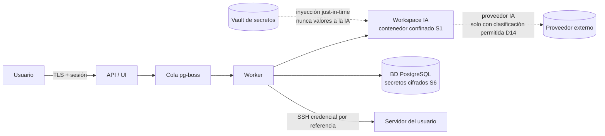

# Matriz de permisos y límites de confianza — Fase 0 (entregable M0)

**Fuente:** Plan Maestro §6.2, decisión 1 (roles desde el inicio), §13 (riesgo: IA con permisos excesivos) · **Regla base:** **denegado por defecto** (CONSTRAINTS §1.4); toda excepción está en esta matriz.

## Actores

| Actor | Qué es |
|---|---|
| `admin` | Humano administrador de la plataforma |
| `desarrollador` | Humano del equipo que usa IA y Git |
| `operador` | Humano que despliega y opera servidores |
| `espectador` | Humano de solo lectura |
| `ia` | **Actor de seguridad propio** (ejecuciones del AI Harness) — no es un usuario |
| `worker` | Procesos internos de la cola (sin UI) |

## Matriz roles × recursos (v1.0)

| Acción | admin | desarrollador | operador | espectador | ia (L2) |
|---|---|---|---|---|---|
| Proyectos: crear / editar / eliminar | ✓ / ✓ / ✓ | ✓ / ✓ / — | — / — / — | — / — / — | — / — / — |
| Repos: clonar, leer diff, commit local | ✓ | ✓ | — | ✓ (lectura) | ✓ (con plan aprobado) |
| Repos: push a remoto | ✓ | ✓ | — | — | — (siempre humano) |
| Trabajos: lanzar / cancelar | ✓ / ✓ | ✓ / ✓ (propios) | ✓ / ✓ | — / — | encola vía harness |
| Secretos: crear / rotar | ✓ / ✓ | — / — | — / — | — / — | — / — |
| Secretos: **usar** (inyección JIT) | ✓ | ✓ | ✓ | — | ✓ (solo referencia; nunca ve valor) |
| Servidores: conectar terminal / ejecutar comando | ✓ / ✓ | ✓ / ✓ (proyectos propios) | ✓ / ✓ | — / — | — (vía harness L3, futuro P2) |
| Servidores: transferir SFTP | ✓ | ✓ | ✓ | — | — |
| Despliegue a `desarrollo` | ✓ | ✓ | ✓ | — | ✓ (autonomía L2) |
| Despliegue a `preproduccion` | ✓ | ✓ | ✓ | — | ✓ solo con plan aprobado (L1) |
| Despliegue a `produccion` (ejecutar) | ✓ | — | ✓ | — | — **siempre** |
| **Aprobación de producción** | ✓ | — | — | — | — **humano siempre** (decisión 8; sin excepciones ni banderas) |
| Rollback (dev/pre) | ✓ | ✓ | ✓ | — | ✓ (procede del plan) |
| Rollback (producción) | ✓ | — | ✓ | — | — propone, humano aprueba |
| Auditoría: leer | ✓ | propia | propia | — | — |
| Auditoría: editar / borrar | **— (append-only)** | — | — | — | — |
| Administración: usuarios, roles, backups | ✓ | — | — | — | — |

Reglas de alcance adicionales: los permisos de servidor y entorno se **restringen por proyecto** (plan §7 Fase 4: permisos por usuario/servidor/acción); `espectador` ve despliegues y salud, no secretos ni terminales.

## Niveles de autonomía de la IA (E05, plan §7 Fase 2)

| Nivel | Nombre | Qué puede hacer la IA | Gate |
|---|---|---|---|
| L0 | Lectura | leer repo, proponer plan | diff visible, nada se aplica |
| L1 | Plan aprobado | aplicar **solo** los pasos del plan aprobado; toda desviación vuelve a L0 | humano aprueba plan |
| L2 | Auto en desarrollo | editar, ejecutar pruebas, checkpoint y rollback en entornos `desarrollo` | límites de gasto (decisión 11), hooks de política |
| L3 | Auto supervisada (P2) | incluye `preproduccion` y comandos de servidor acotados | hooks + aprobación por excepción |

Límites duros en **todos** los niveles: la IA nunca ve valores de secretos (inyección just-in-time); nunca hace push ni despliega a producción; el contenido del repo se trata como **no confiable** (posible inyección de instrucciones, §13); toda acción queda en `auditoria` con `actor_tipo='ia'`.

## Límites de confianza (fronteras)

| Frontera | Confía en | No confía en | Control |
|---|---|---|---|
| Internet → API | nada | todo | auth fuerte, red privada/VPN (decisión 9), rate limit (Fase 8) |
| API → cola | worker autenticado interno | payload | esquema validado, sin secretos en payload |
| Worker → workspace | sus propias tareas | **el código del repo** (inyección) | contenedor S1: red none, cap-drop ALL, solo workspace, read-only |
| Workspace → proveedor IA | — | salida de datos no autorizada | clasificación del proyecto (D14), exclusión de archivos sensibles, redacción de secretos |
| Vault → harness | — | que la IA pida valores | inyección just-in-time al proceso de ejecución; la API de secretos no devuelve valores a la capa IA |
| Harness → servidor | credencial por referencia | comandos arbitrarios | matriz usuario/servidor/acción + auditoría de sesiones (P0) |

## Reglas de coerción (quién vigila la matriz)

1. La matriz vive en **código** (no solo en esta doc); cada endpoint de la API declara el permiso que exige y un test lo verifica (CONSTRAINTS §2).
2. Toda negación se registra en `auditoria` (intento, actor, recurso) — la matriz sin evidencia no es matriz.
3. Cambiar esta matriz = ADR + test actualizado; añadir una excepción "por conveniencia" es la violación típica nº 1 (CONSTRAINTS §6).
