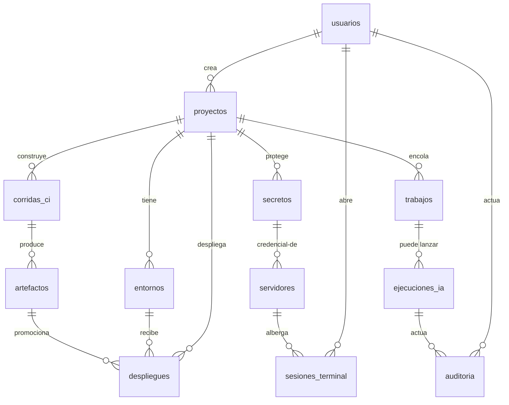

# Modelo de datos inicial — Fase 0 (entregable M0)

**Fuente:** Plan Maestro §6.2 · **Estado:** inicial, se amplía por ADR · **Reglas transversales:** ver §Convenciones.

## Entidades v1.0 (10 núcleo + 2 de soporte M3)

### 1. usuarios
| Campo | Tipo | Notas |
|---|---|---|
| id | uuid PK | |
| email | text UNIQUE | login |
| nombre | text | |
| rol | enum `admin · desarrollador · operador · espectador` | matriz en [matriz-permisos.md](matriz-permisos.md); denegado por defecto |
| activo | bool | baja lógica (nunca borrar: auditoría) |
| creado_en | timestamptz | |

### 2. proyectos
| Campo | Tipo | Notas |
|---|---|---|
| id | uuid PK | |
| nombre / slug | text / text UNIQUE | slug para URLs y `edp` CLI |
| repo_url | text NULL | adaptador GitHub (decisión 2); NULL = solo local |
| clasificacion | enum `local · nube_con_exclusiones` | decisión 14: qué puede salir a proveedores IA |
| creado_por → usuarios | FK | |

### 3. entornos
| Campo | Tipo | Notas |
|---|---|---|
| id | uuid PK | |
| proyecto_id → proyectos | FK | |
| nombre | enum `desarrollo · preproduccion · produccion` | decisión 5: despliegue a estos tres |
| requiere_aprobacion | bool | `produccion` siempre true (decisión 8, sin excepciones) |
| variables_ref | jsonb | **referencias** a secretos, nunca valores |

### 4. servidores
| Campo | Tipo | Notas |
|---|---|---|
| id | uuid PK | |
| nombre / host / puerto | text / text / int | Linux + OpenSSH (decisión 6) |
| credencial_id → secretos | FK | **por referencia** (plan §7 Fase 4): nunca inline |
| creado_en | timestamptz | |

### 5. secretos — cifrado por capas verificado en S6 (ADR-0005)
| Campo | Tipo | Notas |
|---|---|---|
| id | uuid PK | |
| proyecto_id → proyectos | FK NULL | algunos secretos son de plataforma |
| nombre | text | **en claro por diseño** (el valor es lo secreto) |
| enc_dek, dek_iv, dek_tag | bytea | DEK envuelta con la clave maestra (AES-256-GCM) |
| ciphertext, iv, tag | bytea | valor cifrado con la DEK |
| rotado_en, expira_en | timestamptz NULL | rotación (E03 P1) |
| creado_por → usuarios | FK | |

**Invariants:** clave maestra **fuera de la BD** (archivo restringido/KMS local); un `pg_dump` no revela valores (evidencia S6); redacción obligatoria en logs (CONSTRAINTS §1.2).

### 6. trabajos — cola pg-boss v12 sobre PostgreSQL (S3, ADR-0004)
La ejecución vive en el esquema `pgboss.job` (estados reales: `created · retry · active · completed · cancelled · failed`). La tabla de negocio guarda el *qué y quién* para UI y auditoría:

| Campo | Tipo | Notas |
|---|---|---|
| id | uuid PK | |
| pgboss_job_id | uuid | vínculo con la cola |
| proyecto_id → proyectos | FK | |
| tipo | enum `ci · despliegue · ia_tarea · mantenimiento` | |
| payload_ref | jsonb | sin secretos; referencias a recursos |
| estado_espejo | enum (mismos de pgboss) | espejo para listado UI |

**Máquina de estados** (real, de pg-boss v12): `created → active → completed | failed | cancelled`, con `active → retry → active` en reintento. Persistencia ante reinicios verificada en S3.

### 7. ejecuciones_ia — AI Harness (E05)
| Campo | Tipo | Notas |
|---|---|---|
| id / proyecto_id | uuid PK / FK | |
| trabajo_id → trabajos | FK NULL | si corre encolada |
| proveedor / modelo | text | interfaz agnóstica (decisión 3) |
| plan | jsonb | plan aprobado antes de ejecutar (plan §7 Fase 2) |
| estado | enum `planificando · esperando_aprobacion · ejecutando · completada · fallida · revertida` | |
| checkpoint_commit | text | commit de git por paso (S4, ADR-0008) |
| resumen_estado | text | lo que el proveedor entrante necesita (S5, ADR-0007) |
| failover_desde | text NULL | proveedor anterior si hubo failover |
| tokens_in / tokens_out / coste_est | int / int / numeric | límites de gasto (decisión 11) |

### 8. corridas_ci (E09)
| Campo | Tipo | Notas |
|---|---|---|
| id / proyecto_id | uuid PK / FK | |
| commit_sha | text | reproducible: resultados y artefactos consultables tras reiniciar (puerta Fase 5) |
| estado | enum `pendiente · ejecutando · exitosa · fallida · cancelada` | |
| pipeline_path | text | pipelines como código |

### 9. artefactos
| Campo | Tipo | Notas |
|---|---|---|
| id / corrida_ci_id → corridas_ci | uuid PK / FK | |
| etiqueta | text | imagen:revisión — lo que despliega el CD |
| digest | text | sha256 — integridad |
| retenido_hasta | date | decisión 10: últimas N versiones por proyecto |

### 10. despliegues (E10)
| Campo | Tipo | Notas |
|---|---|---|
| id / proyecto_id / entorno_id | uuid PK / FK / FK | |
| artefacto_id → artefactos | FK | promoción por digest (plan §7 Fase 6) |
| estrategia | enum `recreate` | v1.0 (decisión 5) |
| estado | enum `pendiente · aprobando · desplegando · verificando · exitoso · fallido · en_rollback` | **comando terminado ≠ aplicación saludable** (puerta Fase 6) |
| version_esperada / version_detectada | text | la verificación compara ambas (compromiso 2) |
| health_url | text | health checks en verde para `exitoso` |
| aprobado_por → usuarios | FK NULL | `produccion`: FK NOT NULL — aprobación humana siempre (decisión 8) |
| despliegue_previo_id | FK self NULL | rollback documentado |

**Máquina de estados del despliegue:** `pendiente → aprobando → desplegando → verificando → exitoso | fallido → en_rollback → exitoso (a versión previa)`. Nunca se marca `exitoso` sin versión detectada == esperada **y** health en verde.

### 11. sesiones_terminal (E08, P0 tras v1.1)
| Campo | Tipo | Notas |
|---|---|---|
| id / usuario_id / servidor_id | uuid PK / FK / FK | |
| abierta_en / cerrada_en | timestamptz | auditoría de sesiones (compromiso 5) |
| comandos_log_ref | text | referencia al registro de comandos ejecutados |

### 12. auditoria — append-only (compromiso 5)
| Campo | Tipo | Notas |
|---|---|---|
| id | bigserial PK | |
| actor_id | text | usuario, id de IA (ejecucion_ia), worker o sistema |
| actor_tipo | enum `usuario · ia · worker · sistema` | la IA es actor de seguridad propio |
| accion | text | p. ej. `despliegue.aprobar`, `secreto.usar`, `terminal.comando` |
| recurso_tipo / recurso_id | text / text | |
| detalle | jsonb | **sin secretos** (redacción obligatoria) |
| creado_en | timestamptz | retención 1 año (decisión 10); `INSERT` only |

## Relaciones (vista general)

## Convenciones

1. **PK uuid v7** (ordenables por tiempo) salvo `auditoria` (bigserial append-only).
2. **Borrado lógico** en entidades con valor de auditoría (usuarios, proyectos, servidores); físico solo en artefactos expirados (decisión 10).
3. **Toda mutación relevante escribe en `auditoria`** en la misma transacción (compromiso 5).
4. **Cero secretos en cualquier campo de texto libre o log** — solo referencias y ciphertext (CONSTRAINTS §1.2; evidencia S6).
5. Los estados reflejan **realidad verificada**: despliegue `exitoso` exige evidencia (versión + health), trabajo `completed` exige salida del worker.
6. Migraciones **compatibles hacia atrás** + backup previo (§13, riesgo de rollback incompatible).
